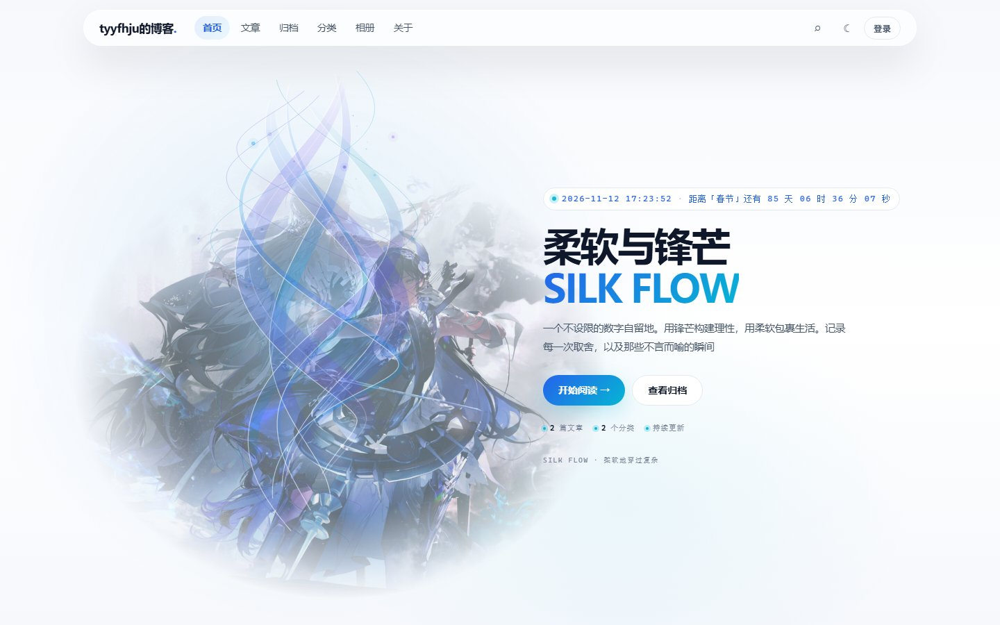
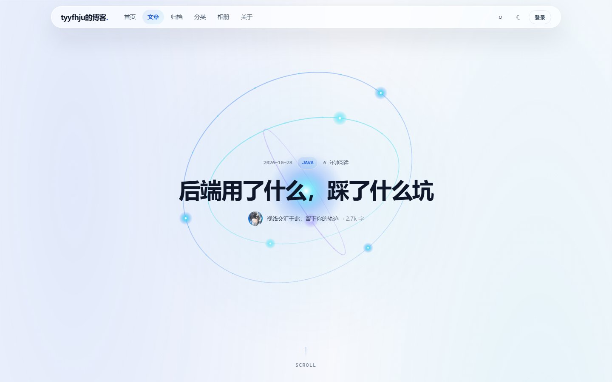
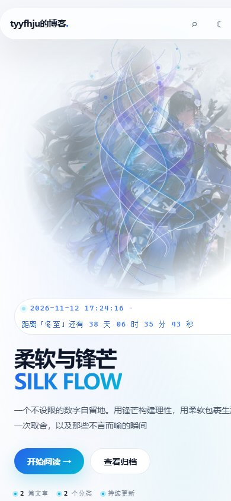
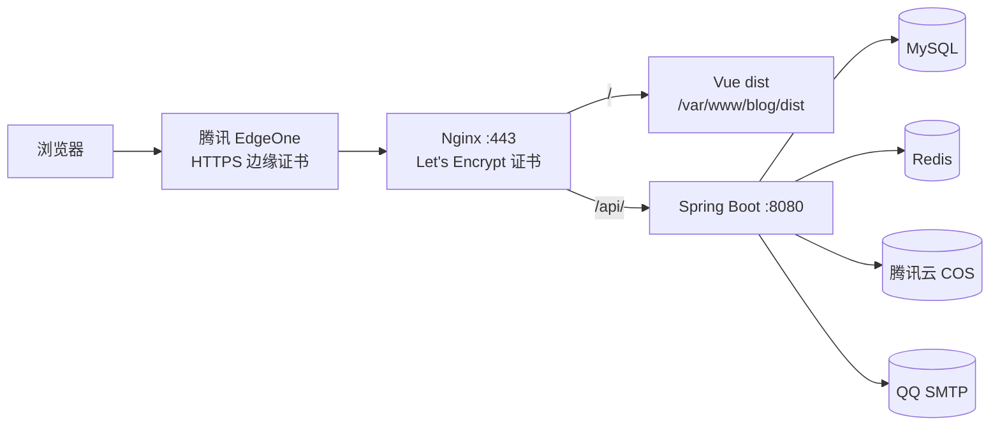

# 个人博客 · 后端

这是我自己的博客后端，前后端分开写的。

线上地址：<https://xn--hlry9isyc4tas57t.com>

前端在另一个仓库：[tyyfhju/blog-frontend](https://github.com/tyyfhju/blog-frontend)

## 页面预览

| 首页 | 文章页 |
| --- | --- |
| [](https://xn--hlry9isyc4tas57t.com/) | [](https://xn--hlry9isyc4tas57t.com/article/17) |

<p align="center">
  
</p>

截图就是线上站点的实际效果。

## 这个博客有什么

- 首页、文章列表、文章详情、归档、分类、相册、关于
- 搜索、点赞、上下篇、相关推荐
- 评论和关于页留言都得登录才能发，作者显示登录邮箱
- 注册、登录、邮箱验证码、找回密码
- 一个账号只能一台设备登录，后登录的会把前一台挤下线
- 邮件订阅，发新文章会通知订阅的人，邮件里能直接退订
- 后台能管文章、分类、标签、用户、评论、留言、相册和站点设置
- 文章和相册图片传到腾讯云 COS，不占服务器硬盘

## 用的什么

后端是 Java 8 + Spring Boot 2.6.13，JPA 操作 MySQL，Redis 存验证码、登录失败次数和单设备登录的会话 ID，Spring Security + JWT 做登录，邮件走 QQ 邮箱 SMTP，图片走腾讯云 COS。

前端是 Vue 2.6 + Vue Router 3 + Vuex 3。后台用了 Element UI，前台样式和动画是自己写的。

部署是 Ubuntu 22.04 + Nginx + systemd。线上前面还挂了腾讯 EdgeOne，证书是源站和 EdgeOne 两套。jar 放 `/opt/blog`，前端 `dist` 放 `/var/www/blog/dist`。

## 整体怎么跑



浏览器先到 EdgeOne，EdgeOne 再回源到 Nginx 的 443。Nginx 把 `/` 交给 Vue 的 `dist`，把 `/api/` 转给本机 `127.0.0.1:8080` 的 Spring Boot。后端再连 MySQL、Redis、COS 和邮箱。

后端只监听 `127.0.0.1`，外面只开 Nginx 的 80 和 443。

## EdgeOne 和证书续期

线上是两套证书，别搞混：

- 源站：certbot 管 `/etc/letsencrypt/live/<域名>/`，Nginx 直接用它。
- EdgeOne：它读不到源站那张证书，需要单独一张边缘证书。

所以 certbot 续期成功后，还要把新证书推到 EdgeOne。我这边是这么做的：

1. certbot 续期成功，自动执行 `/etc/letsencrypt/renewal-hooks/deploy/sync-to-edgeone.sh`
2. hook 调 `/usr/local/bin/sync-edgeone-cert.py`
3. 脚本把 `fullchain.pem` 和 `privkey.pem` 上传到腾讯云 SSL，拿到 `CertificateId`
4. 再调 EdgeOne 的 `ModifyHostsCertificate`，把证书绑到根域名和 `www`

手动测一遍：

```bash
sudo /etc/letsencrypt/renewal-hooks/deploy/sync-to-edgeone.sh
sudo tail -n 30 /var/log/cert-sync.log
```

看源站和 EdgeOne 实际用的证书：

```bash
for h in <域名> www.<域名>; do
  echo "== $h =="
  echo | openssl s_client -servername "$h" -connect "$h":443 2>/dev/null \
    | openssl x509 -noout -subject -issuer -dates
done
```

再看源站自己的：

```bash
echo | openssl s_client -servername <域名> -connect 127.0.0.1:443 2>/dev/null \
  | openssl x509 -noout -subject -issuer -dates
```

三个都显示同一个到期时间，就说明源站和 EdgeOne 都是新证书了。

注意几点：

- EdgeOne 的证书不会跟着源站自动续，必须有这个 hook。
- 脚本失败时 certbot 可能还是显示续期成功，所以要去 `/var/log/cert-sync.log` 看有没有报错。
- 腾讯云 API 密钥放服务器上的 root 600 环境文件里，别写死在脚本，也别提交到仓库。
- 源站最好只允许 EdgeOne 回源，不然别人拿到源站 IP 可以绕过 EdgeOne。

## 目录大概是这样

```text
backend/
├── src/main/java/com/zjy/blog/
│   ├── controller/          前台接口
│   ├── controller/admin/    后台接口
│   ├── service/             业务逻辑
│   ├── repository/          JPA
│   ├── entity/              实体类
│   ├── security/            JWT、单设备会话
│   ├── config/              Security、异常处理、CORS
│   ├── dto/                 请求体
│   └── util/                Redis、COS 这些
├── src/main/resources/
│   ├── application.example.yml
│   └── static/
├── DEPLOY.md                详细部署步骤
├── add_columns.sql
└── pom.xml
```

数据库主要就这些表：`user`、`article`、`category`、`tag`、`article_tag`、`comment`、`message`、`photo`、`photo_album`、`article_like`、`blog_setting`。

第一次启动时 JPA 会自动建表、补字段。已经有数据的环境，升级前先备份，别直接上。

## 本地怎么启动

需要 JDK 8、Maven、MySQL、Redis。前端另外要 Node 14+。

先把配置复制一份：

```bash
cp src/main/resources/application.example.yml src/main/resources/application.yml
```

然后把数据库、Redis、邮箱、COS、JWT 这些填成自己的。真实的 `application.yml` 不会提交，仓库里只有模板。

启动后端：

```bash
mvn spring-boot:run
```

默认是 `http://localhost:8080`。

前端在另一个仓库：

```bash
npm install
npm run serve
```

默认 `http://localhost:8081`，`/api` 会代理到 8080。

## 配置

主要就这几项：

- `spring.datasource.*`：MySQL 地址、库名、账号密码
- `spring.redis.*`：Redis 地址和密码
- `spring.mail.*`：发验证码和通知邮件的邮箱、授权码
- `cos.*`：腾讯云 COS 的地域、Bucket、SecretId、SecretKey
- `app.jwt.secret`：JWT 签名密钥，别用示例值
- `app.jwt.expiration-ms`：登录 token 有效期
- `app.site-url`：邮件里链接用的站点地址，默认就是正式域名

## 服务器怎么部署

我一般按这个顺序来，详细版在 [DEPLOY.md](DEPLOY.md)。

### 1. 本地打包

```bash
mvn clean package -DskipTests
```

产物：

```text
target/blog-0.0.1-SNAPSHOT.jar
```

### 2. 放后端

```bash
sudo mkdir -p /opt/blog
sudo useradd --system --home /opt/blog --shell /usr/sbin/nologin blog 2>/dev/null || true
sudo chown -R blog:blog /opt/blog
```

上传两个文件：

```text
本地 target/blog-0.0.1-SNAPSHOT.jar  ->  /opt/blog/blog.jar
本地 src/main/resources/application.yml  ->  /opt/blog/application.yml
```

然后改权限：

```bash
sudo chown blog:blog /opt/blog/blog.jar /opt/blog/application.yml
sudo chmod 600 /opt/blog/application.yml
```

### 3. systemd

```bash
sudo tee /etc/systemd/system/blog.service > /dev/null <<'EOF'
[Unit]
Description=Blog Backend
After=network.target mysql.service redis-server.service

[Service]
User=blog
Group=blog
WorkingDirectory=/opt/blog
ExecStart=/usr/bin/java -Xms256m -Xmx512m -jar /opt/blog/blog.jar --spring.config.location=file:/opt/blog/application.yml
SuccessExitStatus=143
Restart=on-failure
RestartSec=5
StandardOutput=journal
StandardError=journal

[Install]
WantedBy=multi-user.target
EOF
```

```bash
sudo systemctl daemon-reload
sudo systemctl enable --now blog
sudo systemctl status blog --no-pager
```

出问题先看日志：

```bash
sudo journalctl -u blog -n 100 --no-pager
```

### 4. 放前端

把本地 `dist` 里面的内容传到：

```text
/var/www/blog/dist/
```

别传成 `/var/www/blog/dist/dist`。然后改权限：

```bash
sudo chown -R www-data:www-data /var/www/blog
sudo find /var/www/blog -type d -exec chmod 755 {} \;
sudo find /var/www/blog -type f -exec chmod 644 {} \;
```

### 5. Nginx

```nginx
server {
    listen 80;
    listen [::]:80;
    server_name <域名> www.<域名>;

    root /var/www/blog/dist;
    index index.html;
    client_max_body_size 50m;

    location ^~ /api/ {
        proxy_pass http://127.0.0.1:8080;
        proxy_set_header Host $host;
        proxy_set_header X-Real-IP $remote_addr;
        proxy_set_header X-Forwarded-For $proxy_add_x_forwarded_for;
        proxy_set_header X-Forwarded-Proto $scheme;
    }

    location = /sitemap.xml {
        proxy_pass http://127.0.0.1:8080;
        proxy_set_header Host $host;
    }

    location / {
        try_files $uri $uri/ /index.html;
    }
}
```

```bash
sudo ln -sf /etc/nginx/sites-available/blog /etc/nginx/sites-enabled/blog
sudo nginx -t
sudo systemctl reload nginx
```

### 6. HTTPS

```bash
sudo certbot --nginx -d <域名> -d www.<域名> \
  --redirect --agree-tos -m <邮箱> --no-eff-email
```

源站证书续期后，会自动跑上面说的 EdgeOne 同步 hook。第一次部署建议先手动执行一遍，确认 EdgeOne 那边也拿到证书了。

### 7. 防火墙

只放 22、80、443，`8080`、`3306`、`6379` 不要对公网开。

```bash
sudo ufw allow OpenSSH
sudo ufw allow 'Nginx Full'
sudo ufw enable
```

云服务器安全组也要放行 22、80、443。

### 8. 更新版本

后端：

```bash
sudo systemctl stop blog
# 上传新的 blog.jar 覆盖 /opt/blog/blog.jar
sudo chown blog:blog /opt/blog/blog.jar
sudo systemctl start blog
sudo systemctl status blog --no-pager
```

前端：

```bash
# 新的 dist 内容覆盖 /var/www/blog/dist
sudo chown -R www-data:www-data /var/www/blog
```

静态文件换完一般不用重启 Nginx，真要重启就：

```bash
sudo systemctl reload nginx
```

## 上线前看一眼

- 首页、文章列表、文章详情、归档、分类、相册、关于都能打开
- 登录、注册、找回密码正常
- 评论和留言必须登录，作者显示登录邮箱
- 后台能上传图片、发文章
- 发一篇新文章，订阅的人能收到邮件
- 邮件里的「一键退订」能点
- `https://<域名>/sitemap.xml` 能打开
- `sudo journalctl -u blog -n 100 --no-pager` 没有 ERROR
- 手机宽度下页面不横向滚动

## 几个踩过的坑

- `dist` 别传成 `/var/www/blog/dist/dist`，多一层就是 404。
- 覆盖 jar 后记得 `chown blog:blog`，不然服务起不来。
- 别把 `application.yml` 提交上去，里面有数据库密码、邮箱授权码和 COS 密钥。
- 后端只监听 `127.0.0.1`，3306 和 6379 别对公网开。
- 升级前先备份数据库和旧 jar，出问题能退回去。
- 只换前端时后端不用动；只换后端时前端静态文件也不用动。

## 说明

这个仓库主要是给自己博客用的，目前没有 LICENSE 文件。
