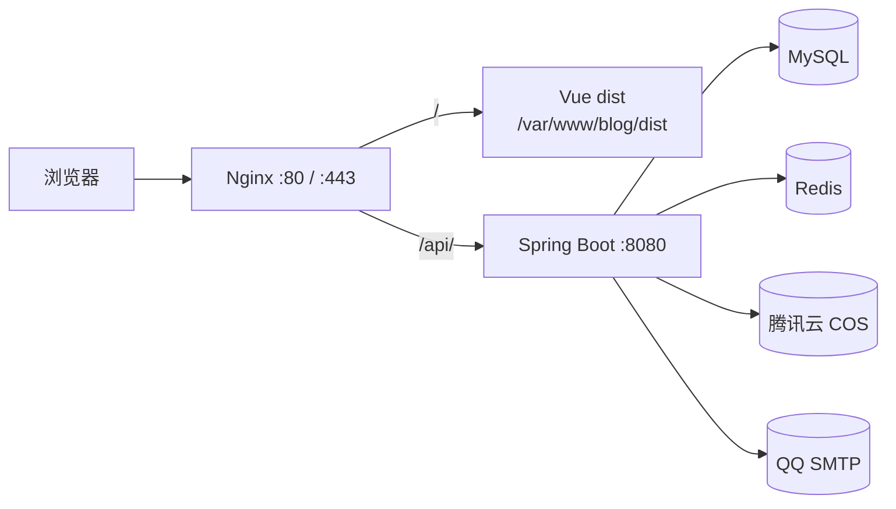

# 个人博客 · 后端

一个前后端分离的个人博客系统，包含前台展示、后台管理、登录注册、评论留言、相册、邮件订阅和文章发布通知。

- 线上地址：<https://xn--hlry9isyc4tas57t.com>
- 前端仓库：[tyyfhju/blog-frontend](https://github.com/tyyfhju/blog-frontend)
- 后端仓库：[tyyfhju/blog-backend](https://github.com/tyyfhju/blog-backend)

## 功能

**前台**

- 首页、文章列表、文章详情、归档、分类、相册、关于
- 全站搜索、文章点赞、上下篇、相关推荐
- 评论和关于页留言：必须登录，作者显示登录邮箱
- 注册、登录、邮箱验证码、找回密码
- 同一账号只允许一台设备登录，后登录会挤掉前一台
- 邮件订阅：发布新文章时发送 HTML 邮件，邮件内可一键退订
- 深浅主题、移动端适配、Sitemap

**后台**

- 仪表盘、文章、分类、标签、用户、评论、留言、相册、博客设置
- 文章草稿/发布、封面上传、Markdown 编辑
- 头像、首页大图、站点文案、社交链接配置
- 评论/留言管理、用户禁用、相册管理

**后端能力**

- JWT 登录、单设备会话、登录失败限流
- 邮箱验证码、图形验证码、密码重置
- COS 图片上传与文件代理
- 敏感词过滤、分页上限、级联删除
- 最后一个管理员保护、统一异常处理
- 文章发布邮件通知、HTML 邮件模板、一键退订

## 技术栈

| 层 | 技术 |
| --- | --- |
| 语言 | Java 8 |
| 框架 | Spring Boot 2.6.13 |
| 数据访问 | Spring Data JPA / Hibernate |
| 数据库 | MySQL 5.7 / 8.0 |
| 缓存 | Redis |
| 安全 | Spring Security + JWT (jjwt 0.11.5) |
| 邮件 | Spring Mail + QQ SMTP |
| 对象存储 | 腾讯云 COS |
| 构建 | Maven |
| 部署 | Ubuntu 22.04 + Nginx + systemd |
| 前端 | Vue 2.6 + Vue Router 3 + Vuex 3 + Element UI |

## 架构



- Nginx 负责静态页面、HTTPS 和 `/api/` 反向代理。
- Spring Boot 只监听 `127.0.0.1:8080`，不直接暴露到公网。
- MySQL 存业务数据，Redis 存验证码、登录失败计数和单设备登录的会话 ID。
- 图片上传到腾讯云 COS，通过后端文件代理访问。
- 邮件用于注册验证码、找回密码和新文章通知。

## 目录结构

```text
backend/
├── src/main/java/com/zjy/blog/
│   ├── controller/          前台接口
│   ├── controller/admin/    后台接口
│   ├── service/             业务逻辑
│   ├── repository/          JPA Repository
│   ├── entity/              实体类
│   ├── security/            JWT、单设备会话
│   ├── config/              Security、异常处理、CORS
│   ├── dto/                 请求体
│   └── util/                Redis、COS 等工具
├── src/main/resources/
│   ├── application.example.yml   配置模板
│   └── static/
├── DEPLOY.md                详细部署教程
├── add_columns.sql          历史补列脚本
└── pom.xml
```

## 数据表

主要表：

| 表 | 说明 |
| --- | --- |
| `user` | 用户、管理员、订阅开关 |
| `article` | 文章 |
| `category` / `tag` / `article_tag` | 分类、标签、文章标签关联 |
| `comment` | 文章评论 |
| `message` | 关于页留言 |
| `photo` / `photo_album` | 相册和照片 |
| `article_like` | 文章点赞 |
| `blog_setting` | 站点设置和前台文案 |

首次启动时 JPA 会根据实体自动建表或补字段。已有数据的环境，建议先用 Navicat 或 `mysqldump` 备份再升级。

## 本地开发

### 环境要求

- JDK 8
- Maven 3.5+
- MySQL 5.7 / 8.0
- Redis
- Node.js 14+（只跑前端时需要）

### 启动后端

```bash
cd backend
cp src/main/resources/application.example.yml src/main/resources/application.yml
```

编辑 `application.yml`，填好数据库、Redis、邮箱、COS 和 JWT 配置，然后：

```bash
mvn spring-boot:run
```

默认地址：`http://localhost:8080`。

### 启动前端

```bash
cd frontend
npm install
npm run serve
```

默认地址：`http://localhost:8081`，`/api` 会代理到 `http://localhost:8080`。

## 配置说明

`application.yml` 已被 `.gitignore` 排除，仓库里只提交 `application.example.yml`。

| 配置 | 说明 |
| --- | --- |
| `spring.datasource.*` | MySQL 地址、库名、账号密码 |
| `spring.redis.*` | Redis 地址和密码 |
| `spring.mail.*` | SMTP 服务器、发件邮箱、授权码 |
| `cos.*` | 腾讯云 COS 的 SecretId、SecretKey、地域、Bucket |
| `app.jwt.secret` | JWT 签名密钥，必须使用足够长的随机值 |
| `app.jwt.expiration-ms` | 登录 token 有效期 |
| `app.site-url` | 邮件里的站点地址，默认正式域名 |

> 不要把真实的 `application.yml`、数据库密码、邮箱授权码、COS 密钥提交到仓库。

## 部署（Ubuntu 22.04）

完整步骤见 [DEPLOY.md](DEPLOY.md)，下面是主流程。

### 1. 本地构建

```bash
mvn clean package -DskipTests
```

产物：

```text
target/blog-0.0.1-SNAPSHOT.jar
```

前端：

```bash
cd frontend
npm run build
```

产物：`dist/`。

### 2. 服务器目录

```bash
sudo mkdir -p /opt/blog
sudo useradd --system --home /opt/blog --shell /usr/sbin/nologin blog 2>/dev/null || true
sudo chown -R blog:blog /opt/blog
```

上传：

```text
本地 target/blog-0.0.1-SNAPSHOT.jar  ->  /opt/blog/blog.jar
本地 src/main/resources/application.yml  ->  /opt/blog/application.yml
```

```bash
sudo chown blog:blog /opt/blog/blog.jar /opt/blog/application.yml
sudo chmod 600 /opt/blog/application.yml
```

### 3. systemd

```bash
sudo tee /etc/systemd/system/blog.service > /dev/null <<'EOF'
[Unit]
Description=Blog Backend
After=network.target mysql.service redis-server.service

[Service]
User=blog
Group=blog
WorkingDirectory=/opt/blog
ExecStart=/usr/bin/java -Xms256m -Xmx512m -jar /opt/blog/blog.jar --spring.config.location=file:/opt/blog/application.yml
SuccessExitStatus=143
Restart=on-failure
RestartSec=5
StandardOutput=journal
StandardError=journal

[Install]
WantedBy=multi-user.target
EOF
```

```bash
sudo systemctl daemon-reload
sudo systemctl enable --now blog
sudo systemctl status blog --no-pager
```

看日志：

```bash
sudo journalctl -u blog -n 100 --no-pager
```

### 4. 前端

把本地 `dist` 里面的内容上传到：

```text
/var/www/blog/dist/
```

注意不要变成 `/var/www/blog/dist/dist/index.html`。然后：

```bash
sudo chown -R www-data:www-data /var/www/blog
sudo find /var/www/blog -type d -exec chmod 755 {} \;
sudo find /var/www/blog -type f -exec chmod 644 {} \;
```

### 5. Nginx

```nginx
server {
    listen 80;
    listen [::]:80;
    server_name <域名> www.<域名>;

    root /var/www/blog/dist;
    index index.html;
    client_max_body_size 50m;

    location ^~ /api/ {
        proxy_pass http://127.0.0.1:8080;
        proxy_set_header Host $host;
        proxy_set_header X-Real-IP $remote_addr;
        proxy_set_header X-Forwarded-For $proxy_add_x_forwarded_for;
        proxy_set_header X-Forwarded-Proto $scheme;
    }

    location = /sitemap.xml {
        proxy_pass http://127.0.0.1:8080;
        proxy_set_header Host $host;
    }

    location / {
        try_files $uri $uri/ /index.html;
    }
}
```

```bash
sudo ln -sf /etc/nginx/sites-available/blog /etc/nginx/sites-enabled/blog
sudo nginx -t
sudo systemctl reload nginx
```

### 6. HTTPS

```bash
sudo certbot --nginx -d <域名> -d www.<域名> \
  --redirect --agree-tos -m <邮箱> --no-eff-email
```

### 7. 防火墙

只放行 22、80、443。`8080`、`3306`、`6379` 不要对公网开放。

```bash
sudo ufw allow OpenSSH
sudo ufw allow 'Nginx Full'
sudo ufw enable
```

云服务器安全组也要同步放行 22、80、443。

### 8. 更新版本

后端：

```bash
sudo systemctl stop blog
# 上传新的 blog.jar 覆盖 /opt/blog/blog.jar
sudo chown blog:blog /opt/blog/blog.jar
sudo systemctl start blog
sudo systemctl status blog --no-pager
```

前端：

```bash
# 用新的 dist 内容覆盖 /var/www/blog/dist
sudo chown -R www-data:www-data /var/www/blog
```

静态文件不需要重启 Nginx，必要时执行：

```bash
sudo systemctl reload nginx
```

## 上线检查

- 首页、文章列表、文章详情、归档、分类、相册、关于页正常
- 登录、注册、找回密码正常
- 评论和留言必须登录，作者显示登录邮箱
- 后台上传图片、发布文章正常
- 发布新文章后订阅邮件能收到
- 邮件里的「一键退订」能正常退订
- `https://<域名>/sitemap.xml` 能打开
- `sudo journalctl -u blog -n 100 --no-pager` 没有 ERROR
- 手机宽度下页面不横向滚动

## 安全说明

- `application.yml` 不提交，仓库只保留占位模板。
- JWT 密钥使用随机长字符串，不使用示例值。
- 数据库、Redis、COS、邮箱授权码只放在服务器配置里。
- 后端绑定 `127.0.0.1`，公网只开放 Nginx 的 80/443。
- 定期备份 MySQL；升级前先备份数据库和旧 jar。
- 公开仓库不要提交文章数据、用户数据、服务器 IP 和任何密钥。

## 说明

这个仓库主要用于个人博客的开发和部署参考，目前没有附带 LICENSE 文件。
